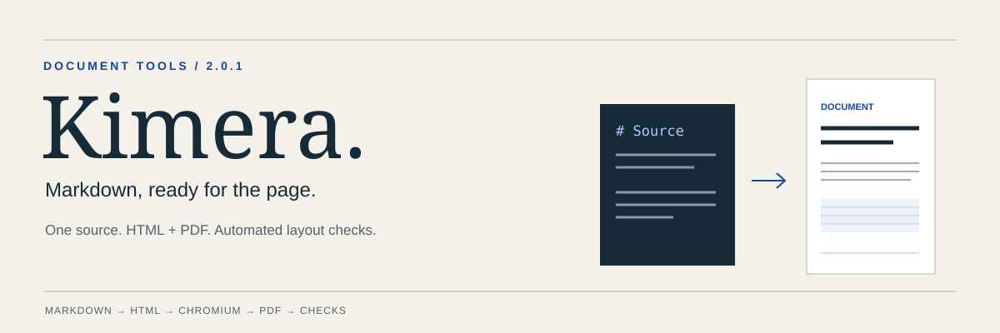
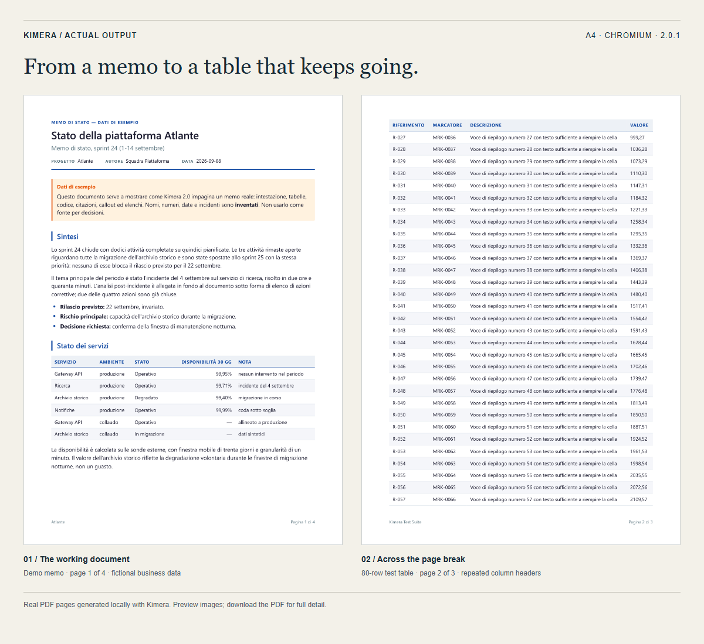

<p align="center">
  
</p>

<p align="center">
  <a href="#quick-start">Quick start</a> · <a href="#see-the-output">See the output</a> · <a href="#use-as-an-agent-skill">Agent skill</a> · <a href="#in-italiano">Italiano</a>
</p>

# Kimera

Turn Markdown into a **self-contained HTML document and a paginated PDF**.
Kimera ships the stylesheet, delegates pagination to Chromium and measures the
PDF it produces. Use it for memos, reports and text-based specifications.

[](.claude-plugin/plugin.json)
[](LICENSE)

The agent writes the content. The renderer handles page size, repeated table
headers, page numbers and footers. The skill keeps its instructions small and
loads detailed references only when needed.

## See the output



**Actual PDF renders, not mockups.** Left: the Italian demo memo, whose business
data is fictional. Right: the second page of the 80-row test table. Both were
rendered with Kimera 2.0.1 on A4. Images are previews; use the PDF for readable detail.

[Read the Markdown](examples/demo-it.md) · [Download the PDF](examples/demo-it.pdf) ·
[Download the standalone HTML](examples/demo-it.md.html)

## Quick start

The setup script below targets **Windows / PowerShell**. It installs dependencies
into a dedicated virtual environment and downloads Chromium through Playwright.
Python 3.10+ is required.

```powershell
git clone https://github.com/Bottega-Alu/kimera.git
cd kimera
powershell -ExecutionPolicy Bypass -File skills/kimera/scripts/setup.ps1
python skills/kimera/scripts/render.py examples/demo-it.md --verify
```

For your own document:

```powershell
python skills/kimera/scripts/render.py report.md --verify --paper A4 --lang en
```

This writes `report.md.html` and `report.pdf` alongside the source. Without
`--verify`, only HTML is produced. The HTML embeds its stylesheet; the PDF is
already paginated and ready to print.

## What you get

| Capability | Behavior |
|---|---|
| Paper | A4, Letter or Legal |
| Pagination | Chromium print layout, CSS page counters and footer margin boxes |
| Tables | Repeated headers; long rows may continue across pages |
| Text | Headings, lists, quotes, code, footnotes and callouts |
| Metadata | Optional title, project, author, date and other known keys |
| Reports | Human-readable summary or JSON with check results and diagnosis |
| Revisions | Keep the Markdown source and render it again |

No metadata is invented. Known metadata keys are consumed only at the start;
ordinary opening lines such as `Nota: pagamento entro 7 giorni` remain content.
See [authoring](skills/kimera/references/authoring.md) for syntax and examples.

## What “VERIFIED” means

Eight automated checks cover paper size, blank pages, text bounds, footers,
rendered-word inclusion, unsupported source constructs, leaked internal tokens
and the Chromium version.

**It is not a guarantee of exact source fidelity or visual approval.** The word
check compares unique words of four or more characters in rendered HTML with the
PDF body. It does not validate word order, repetition counts or short numbers.
Inspect final pages separately, especially dense tables.

When a check fails, the tool provides a diagnosis. The skill permits one
content-preserving formatting fix and one retry. Required content must not be
deleted to obtain a pass. See [verification and diagnosis](skills/kimera/references/printing.md).

## Use as an agent skill

Copy `skills/kimera` into the skill directory used by your agent, for example:

- Codex: `~/.agents/skills/kimera`
- Claude Code: `~/.claude/skills/kimera`

Run `scripts/setup.ps1` from the installed copy once. Ask the agent to use Kimera
to produce a printable document from your content. The renderer also works
directly from the CLI without an agent.

## CLI reference

```powershell
python skills/kimera/scripts/render.py SOURCE.md --verify --report report.json
```

| Option | Purpose |
|---|---|
| `--verify` | Produce the PDF and run automated checks |
| `--paper A4` | Choose A4, Letter or Legal |
| `--lang en` | Choose English or Italian footer strings (`it` by default) |
| `--out PATH` / `--pdf PATH` | Set HTML / PDF output location |
| `--no-pdf` | With verification, check a temporary PDF without retaining it |
| `--title`, `--subtitle`, `--project`, `--author`, `--date`, `--label` | Override metadata |
| `--confidential TEXT` | Add a supplied confidentiality line |
| `--json` / `--report PATH` | Print / save the machine-readable report |

Exit codes: `0` success, `1` failed check, `2` input or internal error,
`3` missing runtime. Setup options: `-Python -3.11`, `-VenvPath PATH`, `-Force`.

## Limits

- Images are unsupported and cause a source-support failure.
- Raw HTML is not an authoring interface: sanitisation can remove tags and content.
- No custom CSS, inline styles or code syntax highlighting.
- Print layout targets Chromium 131+; Word, LibreOffice and Google Docs fidelity
  is not guaranteed.
- Automated checks do not replace visual review or an exact content comparison.

For manual HTML printing: use current Chromium, matching paper size, 100% scale,
Default margins, and browser headers and footers turned off. Prefer the PDF.

## Development and evidence

```powershell
python tests/run_tests.py
python tests/test_metadata.py
```

Use a Python interpreter with the Kimera dependencies installed. The full suite
checks ten fixtures across A4, Letter and Legal, plus the Italian demo: **31
rendering cases and 5 verifier regressions** passed in the recorded run. The
metadata suite adds **6 passing tests**, including preservation of an opening
note and amount in the actual PDF.

The rendering suite covers long tables, oversized rows, long paragraphs, code,
long strings, page breaks, unsupported images, raw HTML and rich Markdown.
Expected failures are tested as failures. Unique body markers detect dropped
or duplicated content.

[Recorded rendering results](tests/results/test-results.json) ·
[Metadata regressions](tests/test_metadata.py)

```text
skills/kimera/
  SKILL.md                 Agent workflow
  scripts/                 Setup, renderer and PDF verifier
  assets/                  Shared stylesheet and HTML template
  references/              Authoring and printing details
examples/                  Demo source, HTML and PDF
tests/                     Rendering and metadata regressions
```

## In italiano

**Scrivi Markdown, ottieni HTML e PDF impaginati.** Kimera prepara memo, report e
specifiche testuali usando un renderer locale e un foglio di stile condiviso.
Chromium gestisce la paginazione; i controlli misurano il PDF prodotto.

Per iniziare, esegui i comandi in [Quick start](#quick-start). Per usare i piè di
pagina in italiano, passa `--lang it`. Conserva il Markdown per le revisioni.
`VERIFIED` indica che i controlli automatici sono passati: verifica visivamente
il documento finale e controlla separatamente la fedeltà esatta dei contenuti.

## What changed in 2.0.1

- Shorter instructions with references loaded on demand.
- Known-key metadata parsing preserves ordinary opening lines.
- Formatting remedies preserve required content.
- Reports disclose the scope of verification and the absence of visual review.

## License and author

By **[Francesco Trani / Bottega Alu](https://github.com/Bottega-Alu)**.
Kimera is the Italian spelling of *Chimera*: content, layout and checks brought
together in one document workflow.

Non-commercial use: **CC BY-NC 4.0**, with attribution. Commercial use requires
the commercial license described in [LICENSE](LICENSE), available by
[buying the author an aperitivo](https://buymeacoffee.com/bottega.alu).
Kimera(R) is a trademark of Francesco Trani.

If Kimera helps your work, a star helps others discover it.
